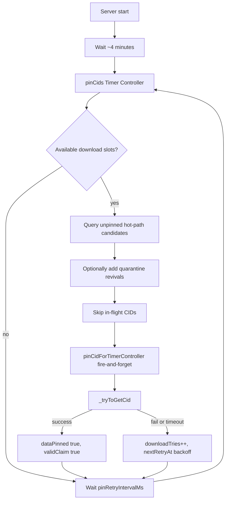

# Periodic Pin Retry

High-level overview of the background loop that retries downloading and pinning files for Pin Claims that were not completed at submit time.

For the full claim lifecycle (PoB validation, renewal, submit-time `pinCid`), see [pin-claim-processing.md](./pin-claim-processing.md).

## Why it exists

Submitting a pin claim via `POST /ipfs/pin-claim` validates the proof-of-burn and immediately kicks off `pinCid()` without waiting for it to finish. That is intentional: the API should return quickly.

IPFS content is often not reachable yet when the claim is first seen (publisher offline, DHT not warmed up, peers not connected). A single download attempt at submit time will frequently fail even though the claim is valid and the file will appear later.

The **periodic pin retry** loop keeps working those unfinished claims in the background until the content can be fetched, size/payment can be validated, and the CID is pinned—or until failures age the claim out of the hot path.

## How it works

### Schedule

- First run: ~4 minutes after server start (lets Helia connect).
- Thereafter: every `pinRetryIntervalMs` (default 10 minutes), measured from when the previous round finishes.

### Candidate selection (`pinCids`)

Only **unpinned** claims compete for work (`dataPinned: false`). Already-pinned rows are not loaded into the batch.

**Hot path** (primary):
- `downloadTries < pinRetryMaxTries`
- `nextRetryAt <= now`
- Sorted by fewest tries, then newest `recordTime`
- Limited by `pinRetryBatchSize` and available download slots

**Soft quarantine** (small revival budget):
- Claims that already hit `pinRetryMaxTries`
- Only if `lastDownloadAttempt` is older than `pinRetryQuarantineCooldownMs`
- At most `pinRetryQuarantineBudget` per round (default 2)

There is **no** blanket reset of all `downloadTries`. Exhausted CIDs stay cold except for the small quarantine budget.

### Download and outcome (`_tryToGetCid`)

1. Skip if already pinned or already in the in-memory pin tracker.
2. Mark the CID in-flight (`trackPin`).
3. Download via the retry queue with a ~5-minute timeout (`_getCidWithTimeout`).
4. On success: validate size/payment, pin, DHT-provide, set `dataPinned` / `validClaim`, clear tracker.
5. On any download failure (missing size, timeout, or throw): `_recordDownloadFailure` bumps `downloadTries`, sets `lastDownloadAttempt` and `nextRetryAt` with exponential backoff (`base * 2^(tries-1)`), clears tracker, and returns.

Submit-time `pinCid()` uses the same failure-accounting helper so timeouts and soft failures do not leave a CID stuck forever with `downloadTries: 0`.

### Fairness / backpressure

- Cap how many claims are enqueued by: `concurrency - queueSize - inFlightCount`.
- Do not re-enqueue CIDs already in the pin tracker.
- Download queue p-retry attempts are forced to `0` so a single zombie CID cannot sit in a slot for many sequential 5-minute retries; the timer loop provides persistence instead.

## Key files and fields

| Piece | Location |
| --- | --- |
| Timer loop | `src/controllers/timer-controllers.js` (`pinCids`) |
| Download / pin / failure accounting | `src/use-cases/ipfs.js` (`pinCidForTimerController`, `_tryToGetCid`, `_recordDownloadFailure`) |
| Pin document fields | `downloadTries`, `lastDownloadAttempt`, `nextRetryAt` in `src/adapters/localdb/models/pins.js` |
| Tunables | `config/env/common.js` (`pinRetryBatchSize`, `pinRetryMaxTries`, `pinRetryIntervalMs`, `pinRetryDownloadConcurrency`, `pinRetryBackoffBaseMs`, `pinRetryQuarantineBudget`, `pinRetryQuarantineCooldownMs`) |

Environment variables (optional overrides): `PIN_RETRY_BATCH_SIZE`, `PIN_RETRY_MAX_TRIES`, `PIN_RETRY_INTERVAL_MS`, `PIN_RETRY_DOWNLOAD_CONCURRENCY`, `PIN_RETRY_BACKOFF_BASE_MS`, `PIN_RETRY_QUARANTINE_BUDGET`, `PIN_RETRY_QUARANTINE_COOLDOWN_MS`.
